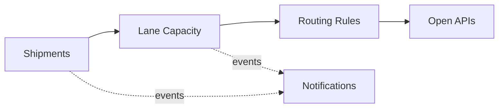

# Domain Model and Bounded Contexts

Ubiquitous language and context design (view VP-4). Domain-standard concepts are mapped
normatively in `../domain/domain-standards.md` (CR-5).

## Ubiquitous language (selected terms)

| Term | Meaning |
|---|---|
| **Shipment** | A road, rail, sea or air shipment; its SSCC is masked |
| **Lane capacity** | A lane's guarded bookable capacity, in kg |
| **Capacity booking** | One booking against lane capacity (FTL, LTL, parcel, container) |
| **Routing rule** | A decision rule binding a transport mode to distance and transit envelopes |
| **Vehicle unit** | A truck, van, train or vessel unit in the fleet catalogue |
| **Shipment risk score** | A transparent 0-100 delay/damage/route risk score |

## Bounded contexts and invariants

### Shipments — `shipment-service`
Shipment registry; the SSCC is masked at creation. Lifecycle: `CREATED` → transitions
dispatch, deliver. Shipment identifiers follow GS1 discipline; the SSCC is validated and never stored or returned in clear beyond its masked form in this reference. Consignee personal data is minimized; all data is synthetic.

### Lane Capacity — `lane-capacity-service`
Guarded lane-capacity accounts and the freight bookings against them. **Invariant (ADR-0004): booked weight on a lane never exceeds the lane's capacity — a booking that would overrun it is rejected (422) and records nothing; capacity is never silently oversold.** Consumption records are
append-only evidence; a rejected operation records nothing.

### Routing Rules — `routing-rules-service`
Decision rules binding transport modes to distance and transit-time envelopes. Only ACTIVE rules decide; evaluation order is by priority; every decision
is ALLOWED / DEGRADED / DENIED with the matched rule and a human-readable reason.

### Fleet Units — `fleet-catalog-service`
Fleet unit catalogue by type and capacity.

### Notifications — `notification-service`
Delivery trail for audit; recipients are never logged.

## Context map

